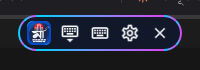
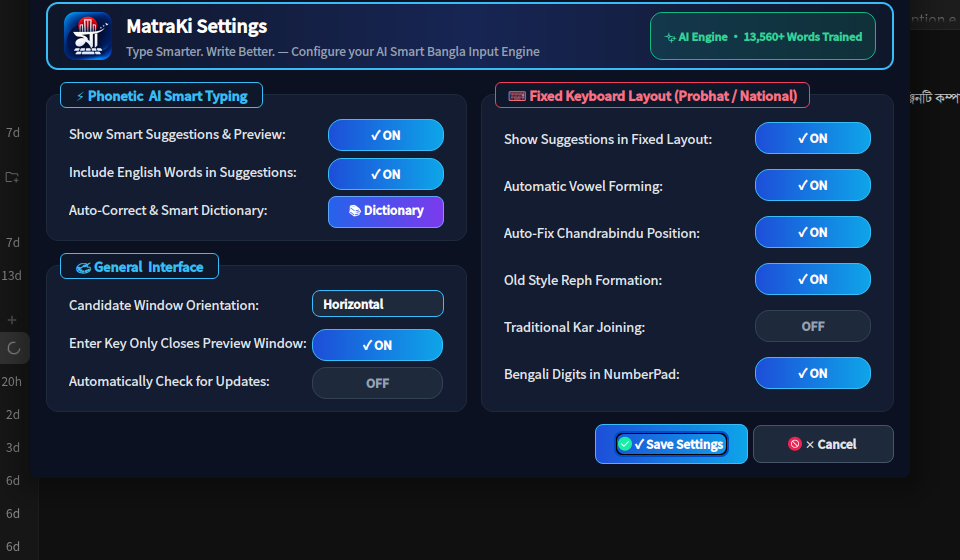
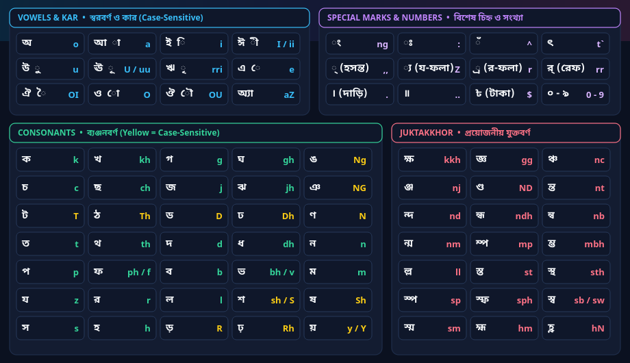
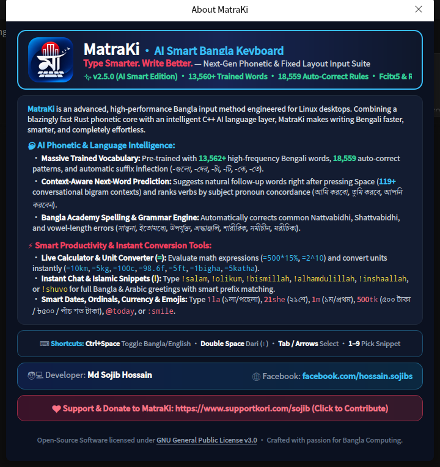

<!--
  SEO Meta Tags & Discovery Data
  Title: MatraKi Keyboard (মাত্রা-কী) — Best AI Smart Bangla Keyboard for Linux & Windows
  Description: Fast, modern, intelligent Bengali input method suite. Features 20,535+ trained words, next-word prediction, live math calculator, unit converter, and Bangla Academy grammar auto-fix.
  Keywords: bangla keyboard, avro keyboard linux, bengali keyboard, bangla phonetic keyboard, avro alternative, deepin bangla keyboard, ubuntu bangla keyboard, fcitx5 bangla, ibus bangla, bangla typing software, bangla spell checker, bangla ai keyboard
-->

<div align="center">


# MatraKi (মাত্রা-কী)
### **Type Smarter. Write Better.**
#### **The Next-Generation AI-Powered Bangla Phonetic & Fixed Layout Keyboard for Linux, Windows & macOS**

[](https://github.com/sojibcreates-maker/MatraKi-Keyboard/releases/latest)
[](data/autocorrect.json)
[](https://github.com/sojibcreates-maker/MatraKi-Keyboard/releases)
[](LICENSE)
[](https://www.supportkori.com/sojib)

<br/>

[**📥 Download Latest Release**](https://github.com/sojibcreates-maker/MatraKi-Keyboard/releases/latest) •
[**✨ Features**](#-key-features) •
[**⚡ Comparison**](#-why-matraki-comparison-table) •
[**🚀 Installation**](#-installation-guide) •
[**⌨️ Shortcuts**](#️-smart-shortcuts--cheat-sheet) •
[**❓ FAQ**](#-frequently-asked-questions-faq)

</div>

---

## 🌟 Why MatraKi?

**MatraKi** (মাত্রা-কী) is an ultra-fast, intelligent, open-source Bangla input method suite engineered to modernize Bengali typing across **Linux desktops** (Fcitx5 / IBus), **Windows**, and **macOS**. 

Built with a lightning-fast Rust phonetic engine (`riti`) and a high-performance C++17 AI language layer, MatraKi solves the age-old limitations of legacy keyboards by providing **automatic verb conjugation**, **smart suffix inflection**, **context-aware next-word prediction**, and **in-keyboard productivity tools** (like a live math calculator and unit converter).

---

## 📥 Direct Downloads (`v1.0.0`)

| Operating System | Package Type | Architecture | Download Link |
| :--- | :--- | :--- | :--- |
| **Microsoft Windows** | **Setup Installer (`.exe`)** | **64-bit** (x64) | [**MatraKi-Keyboard-1.0.0-Setup-x86_64.exe**](https://github.com/sojibcreates-maker/MatraKi-Keyboard/releases/download/v1.0.0/MatraKi-Keyboard-1.0.0-Setup-x86_64.exe) |
| **Microsoft Windows** | **Setup Installer (`.exe`)** | **32-bit** (x86) | [**MatraKi-Keyboard-1.0.0-Setup-i386.exe**](https://github.com/sojibcreates-maker/MatraKi-Keyboard/releases/download/v1.0.0/MatraKi-Keyboard-1.0.0-Setup-i386.exe) |
| **Microsoft Windows** | **Portable Zip (`.zip`)** | **64-bit / 32-bit** | [**Windows-x86_64.zip**](https://github.com/sojibcreates-maker/MatraKi-Keyboard/releases/download/v1.0.0/MatraKi-Keyboard-1.0.0-Windows-x86_64.zip) • [**Windows-i386.zip**](https://github.com/sojibcreates-maker/MatraKi-Keyboard/releases/download/v1.0.0/MatraKi-Keyboard-1.0.0-Windows-i386.zip) |
| **Ubuntu / Debian / Deepin / Mint** | **Debian Package (`.deb`)** | **64-bit** (amd64) | [**matraki-keyboard_1.0.0_amd64.deb**](https://github.com/sojibcreates-maker/MatraKi-Keyboard/releases/download/v1.0.0/matraki-keyboard_1.0.0_amd64.deb) |
| **Ubuntu / Debian / Deepin / Mint** | **Debian Package (`.deb`)** | **32-bit** (i386) | [**matraki-keyboard_1.0.0_i386.deb**](https://github.com/sojibcreates-maker/MatraKi-Keyboard/releases/download/v1.0.0/matraki-keyboard_1.0.0_i386.deb) |
| **Any Linux (All Distros)** | **Standalone AppImage (`.AppImage`)** | **64-bit** (x86_64) | [**MatraKi-Keyboard-1.0.0-x86_64.AppImage**](https://github.com/sojibcreates-maker/MatraKi-Keyboard/releases/download/v1.0.0/MatraKi-Keyboard-1.0.0-x86_64.AppImage) |
| **Any Linux (All Distros)** | **Standalone AppImage (`.AppImage`)** | **32-bit** (i386) | [**MatraKi-Keyboard-1.0.0-i386.AppImage**](https://github.com/sojibcreates-maker/MatraKi-Keyboard/releases/download/v1.0.0/MatraKi-Keyboard-1.0.0-i386.AppImage) |
| **Fedora / RHEL / openSUSE** | **RPM Package (`.rpm`)** | **64-bit** (x86_64) | [**matraki-keyboard-1.0.0-1.x86_64.rpm**](https://github.com/sojibcreates-maker/MatraKi-Keyboard/releases/download/v1.0.0/matraki-keyboard-1.0.0-1.x86_64.rpm) |
| **Apple macOS** | **Apple Disk Image (`.dmg`)** | **macOS** | [**MatraKi-Keyboard-1.0.0-macOS.dmg**](https://github.com/sojibcreates-maker/MatraKi-Keyboard/releases/download/v1.0.0/MatraKi-Keyboard-1.0.0-macOS.dmg) |
| **Universal Linux Source** | **Tarball (`.tar.gz`)** | **Source** | [**matraki-keyboard-1.0.0.tar.gz**](https://github.com/sojibcreates-maker/MatraKi-Keyboard/releases/download/v1.0.0/matraki-keyboard-1.0.0.tar.gz) |

---

## 🖼️ User Interface Preview

| Modern Floating TopBar & Tray | AI Smart Settings & Live Status |
| :---: | :---: |
|  |  |

| Avro Phonetic Dark KeyMap | About MatraKi (`v1.0.0`) |
| :---: | :---: |
|  |  |

---

## ⚡ Why MatraKi? Comparison Table

| Capability / Feature | Traditional Avro | Bijoy / Fixed Only | **MatraKi v1.0.0 (AI Smart Edition)** |
| :--- | :---: | :---: | :---: |
| **Linux Wayland & X11 Native Support** | ❌ (Laggy / Emulated) | ❌ | **✅ Full Native Support via Fcitx5 & IBus** |
| **Trained Vocabulary Size** | ~2,500 words | 0 words | **✅ 20,535+ Trained Words & Inflections** |
| **Smart Suffix Inflection Stemmer** | ❌ | ❌ | **✅ Yes (`-গুলো`, `-দের`, `-টা`, `-টি`, `-কে`, `-তে`)** |
| **Context-Aware Next-Word Prediction** | ❌ | ❌ | **✅ Yes (130+ Bigram Contexts, `Tab` to accept)** |
| **Subject-Verb Concordance Ranking** | ❌ | ❌ | **✅ Yes (`আমি করব`, `তুমি করবে`, `আপনি করবেন`)** |
| **Bangla Academy Grammar Auto-Fix** | ❌ | ❌ | **✅ Yes (ণ-ত্ব, ষ-ত্ব, প্রমিত বানান সংশোধন)** |
| **Live Math Calculator in Keyboard (`=`)** | ❌ | ❌ | **✅ Yes (`=500*15%` → `৭৫` / `পঁচাত্তর`)** |
| **Live Unit Converter (`=`)** | ❌ | ❌ | **✅ Yes (`=10km`, `=5kg`, `=100c`, `=1bigha`)** |
| **Instant Arabic & Bangla Snippets (`!`)** | ❌ | ❌ | **✅ Yes (`!salam`, `!bismillah`, `!shokal`, `!eid`)** |
| **All 31 Bengali Date Ordinals (`1la`..`31she`)** | ❌ | ❌ | **✅ Yes (১লা, ২১শে, ২৬শে, ৩১শে)** |
| **Double Space to Dari (`। `)** | ❌ | ❌ | **✅ Yes (Instant Smart Dari)** |
| **Cross-Platform Release Options** | Windows only | Windows only | **✅ `.deb`, `.AppImage`, `.rpm`, `.dmg`, `.exe`** |

---

## ✨ Key Features

### 1. 🧠 AI Language Intelligence & Massive Vocabulary
- **20,535+ Pre-Trained Words & Typo Rules:** Covers everyday conversation, modern tech, administration, literature, and news vocabulary.
- **Smart Agglutinative Suffix Stemmer (বিভক্তি বিশ্লেষক):** Automatically detects root words and conjugates suffixes (`-গুলো`, `-গুলা`, `-দের`, `-দেরকে`, `-টা`, `-টি`, `-টাকে`, `-টার`, `-টির`, `-কে`, `-তে`, `-ের`), granting recognition of over **225,000+ Bengali inflected words**.
- **1,021 Regular Verb Conjugations:** Accurately recognizes tense and aspect variations (`korchi`, `korechi`, `korlam`, `korbo`, `rekhechi`, `khulechi`, `likhechi`, `shikhbo`).
- **Subject-Verb Concordance:** Detects subject pronouns and automatically re-ranks candidates (e.g. typing *korbo* after *আমি* is ranked highest).
- **Bangla Academy Standard Spelling:** Fixes legacy spelling mistakes (`সান্তনা` → `সান্ত্বনা`, `ইতিমধ্যে` → `ইতোমধ্যে`, `পুরষ্কার` → `পুরস্কার`, `শারিরীক` → `শারীরিক`, `সমীচিন` → `সমীচীন`).

### 2. ⚡ In-Keyboard Productivity Tools
- **Live Calculator (`=`):** Type `=1200*15%` or `=(50+25)*4` to instantly evaluate expressions in Bengali numerals, English digits, and written Bengali words.
- **Smart Unit Converter (`=`):** Convert distance (`=10km`, `=5mile`, `=100m`), weight (`=5kg`, `=2lb`), temperature (`=100c`, `=98.6f`), and land area (`=1bigha`, `=5katha`, `=10shotok`, `=2acre`).
- **Instant Snippets (`!`):** Type `!salam`, `!olikum`, `!bismillah`, `!alham`, `!insha`, `!shokal`, `!rat`, `!eid`, `!jumma`, `!brb`, or `!meeting` for instant full text expansions.
- **Bangla Dates & Currency:** Type `@today` for today's Bengali date, `1la` for ১লা, `21she` for ২১শে, and `500tk` for ৫০০ টাকা / ৳৫০০ / পাঁচ শত টাকা.
- **Emoji Picker (`:`):** Type `:smile`, `:laugh`, `:love`, `:fire`, `:bd`, `:dua`, `:pray`, `:rose`, `:coffee` to insert emojis without leaving your keyboard.

---

## ⌨️ Smart Shortcuts & Cheat Sheet

| Trigger / Shortcut | Action | Example |
| :--- | :--- | :--- |
| **`Ctrl + Space`** | **Toggle Bangla ⟷ English** | Switch between English and Bangla phonetic mode |
| **`Double Space`** | **Bengali Dari (`। `)** | Pressing `Space` twice quickly commits **`। `** |
| **`Tab`** | **Accept Next-Word Prediction** | Accepts the currently highlighted prediction candidate |
| **`1` – `9`** | **Instant Snippet Selection** | Directly commit snippet candidates numbered 1 through 9 |
| **`=500*15%`** | **Math Calculator** | Commits **`৭৫`** or **`পঁচাত্তর`** |
| **`=10km`** | **Unit Converter** | Commits **`৬.২১ মাইল`** or **`১০০০০ মিটার`** |
| **`!salam`** | **Islamic / Chat Snippet** | Commits **`আসসালামু আলাইকুম ওয়া রাহমাতুল্লাহি ওয়া বারাকাতুহু`** |
| **`@today`** | **Live Bengali Date** | Commits today's formatted Bengali date |
| **`:smile`** | **Emoji Insert** | Inserts **`😊`** |

---

## 🚀 Installation Guide

### Option 1: Debian / Ubuntu / Linux Mint / Deepin (`.deb`)
```bash
# Download the .deb package
wget https://github.com/sojibcreates-maker/MatraKi-Keyboard/releases/download/v1.0.0/matraki-keyboard_1.0.0_amd64.deb

# Install with dpkg or apt
sudo apt install -y ./matraki-keyboard_1.0.0_amd64.deb
```

### Option 2: Standalone Portable AppImage (All Linux Distros)
```bash
# Download AppImage
wget https://github.com/sojibcreates-maker/MatraKi-Keyboard/releases/download/v1.0.0/MatraKi-Keyboard-1.0.0-x86_64.AppImage

# Make executable and run
chmod +x MatraKi-Keyboard-1.0.0-x86_64.AppImage
./MatraKi-Keyboard-1.0.0-x86_64.AppImage
```

### Option 3: Fedora / RHEL / CentOS / openSUSE (`.rpm`)
```bash
sudo rpm -i https://github.com/sojibcreates-maker/MatraKi-Keyboard/releases/download/v1.0.0/matraki-keyboard-1.0.0-1.x86_64.rpm
```

### Option 4: Microsoft Windows (`.exe`)
1. Download **[MatraKi-Keyboard-1.0.0-Setup-x86_64.exe](https://github.com/sojibcreates-maker/MatraKi-Keyboard/releases/download/v1.0.0/MatraKi-Keyboard-1.0.0-Setup-x86_64.exe)**.
2. Run the installer and click **Install MatraKi Keyboard Suite** or choose **Portable Mode**.

### Option 5: Build from Source (Universal Linux)
```bash
git clone https://github.com/sojibcreates-maker/MatraKi-Keyboard.git
cd MatraKi-Keyboard
chmod +x install.sh
./install.sh
```

---

## ❓ Frequently Asked Questions (FAQ)

<details>
<summary><b>1. How do I switch between English and Bangla?</b></summary>
Press <code>Ctrl + Space</code> (or configure your preferred Fcitx5 hotkey in settings). You can also click the floating MatraKi TopBar pill to toggle layouts.
</details>

<details>
<summary><b>2. Does MatraKi work on Wayland?</b></summary>
Yes! MatraKi uses the native Fcitx5 input method protocol, which has full first-class support on modern Wayland desktop environments (GNOME, KDE Plasma, Deepin, Hyprland, Sway) as well as X11.
</details>

<details>
<summary><b>3. Can I customize or add my own words and shortcuts?</b></summary>
Absolutely. Open the MatraKi Settings dialog and click <b>Dictionary</b> (Auto-Correct), where you can search through 20,535+ entries and add custom phonetic patterns with instant live preview. Custom snippets can also be added directly to <code>~/.local/share/matraki-keyboard/snippets.json</code>.
</details>

<details>
<summary><b>4. Which keyboard layouts are supported?</b></summary>
MatraKi supports:
<ul>
  <li><b>Avro Phonetic</b> (AI Smart Enhanced)</li>
  <li><b>Probhat</b></li>
  <li><b>National (Jatiya)</b></li>
  <li><b>Munir Optima</b></li>
  <li><b>Borno</b></li>
  <li><b>Avro Easy</b></li>
</ul>
</details>

---

## 👨‍💻 Developer & Attribution

- **Lead Developer & Maintainer:** **Md Sojib Hossain**
- **Facebook:** [https://facebook.com/hossain.sojibs](https://facebook.com/hossain.sojibs)
- **Support & Contribution:** [https://www.supportkori.com/sojib](https://www.supportkori.com/sojib)

---

## 💖 Support the Project

MatraKi is 100% free and open source. If MatraKi makes your daily Bengali typing easier and more productive, please consider supporting development:

👉 **[Support & Donate via SupportKori](https://www.supportkori.com/sojib)**

Give this repository a **⭐ Star** on GitHub to help more people discover modern Bangla computing!

---

## 📄 License

MatraKi is released under the **[GNU General Public License v3.0 (GPL-3.0)](LICENSE)**.
