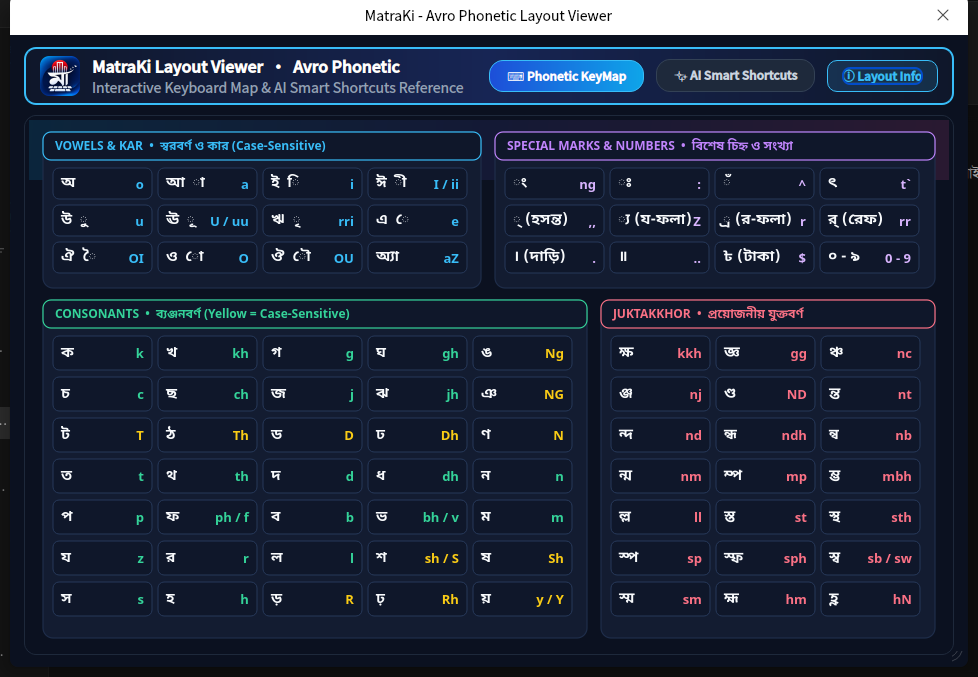

<div align="center">


# MatraKi (মাত্রা-কী)
### **Type Smarter. Write Better.**
**Next-Generation AI Smart Bangla Phonetic & Fixed Layout Keyboard for Linux**

[-0ea5e9?style=for-the-badge)](version.txt)
[](data/autocorrect.json)
[](LICENSE)
[](https://www.supportkori.com/sojib)

</div>

---

## ✨ Overview

**MatraKi** (মাত্রা-কী) is an advanced, high-performance, open-source Bangla input method suite engineered for modern Linux desktops (**Fcitx5** & **IBus**). Combining a fast Rust phonetic core (`riti`) with an intelligent C++17 AI language layer (`SmartFeatures` & `LanguageEngine`) and a sleek Royal-Blue Dark Glassmorphic Qt5 interface, MatraKi makes typing Bengali faster, smarter, and completely effortless.

---

## 🖼️ Screenshots

| Floating TopBar & Tray | Modern English Settings (`v1.0.0`) |
| :---: | :---: |
|  |  |

| Avro Phonetic Modern KeyMap | About MatraKi (`v1.0.0`) |
| :---: | :---: |
|  |  |

---

## 🧠 Key AI & Smart Features

### 1. Massive Pre-Trained Bangla Dictionary & Agglutinative Stemmer
- **20,535+ Auto-Correct & Phonetic Patterns** (`data/autocorrect.json`) and **15,580+ Transliteration & Candidate Selection Entries** (`data/transliteration.json`).
- **1,021+ Pre-Trained Verb Conjugations** across all tenses and persons (`korchi` → করছি, `korechi` → করেছি, `rekhechi` → রেখেছি, `khulechi` → খুলেছি, `likhechi` → লিখেছি).
- **Smart Agglutinative Suffix Stemmer (বিভক্তি বিশ্লেষক):** Automatically recognizes noun stems with attached Bengali suffixes (`-গুলো`, `-দের`, `-দেরকে`, `-টা`, `-টি`, `-টাকে`, `-টার`, `-কে`, `-তে`, `-ের`), enabling instant recognition of **225,000+ inflected Bengali word forms** with $O(1)$ hash lookup.

### 2. Context-Aware Next-Word Prediction & Grammar Engine
- **Next-Word Bigram Prediction:** Suggests contextually relevant follow-up words right after pressing `Space` (**130+ conversational contexts**). Press **`Tab`** to accept the predicted word immediately.
- **Subject-Verb Concordance Ranking:** Automatically prioritizes matching verb endings based on the subject pronoun (`আমি করব/করছি`, `তুমি করবে/করছো`, `আপনি করবেন/করছেন`, `তুই করবি/করছিস`, `সে করবে/করছে`).
- **Bangla Academy Spelling & Grammar Auto-Fix:** Automatically corrects common Nattvabidhi (ণ-ত্ব বিধান), Shattvabidhi (ষ-ত্ব বিধান), vowel-length errors, and Sadhu-to-Cholit verb mixing (`সান্ত্বনা`, `ইতোমধ্যে`, `উপর্যুক্ত`, `শ্রদ্ধাঞ্জলি`, `শারীরিক`, `সমীচীন`, `মরীচিকা`, `পরিষ্কার`, `পুরস্কার`).

### 3. Live In-Keyboard Productivity Tools

| Trigger / Input | Feature | Example Output |
| :--- | :--- | :--- |
| **`=expression`** | **Live Math Calculator** (`+ - * / % ^ ()`) | `=500*15%` → **`৭৫`** / `৭৫ (গণনা)` / `পঁচাত্তর` |
| **`=value+unit`** | **Smart Unit Converter** (`km, mi, m, cm, in, ft, kg, gm, lb, l, c, f, acre, bigha, katha, shotok`) | `=10km` → **`৬.২১ মাইল`** / **`১০০০০ মিটার`**<br>`=1bigha` → **`৩৩ শতক (২০ কাঠা)`** |
| **`!shortcut`** | **Instant Bangla & Arabic Snippets** (Prefix match + `1–9` quick pick) | `!salam` → **`আসসালামু আলাইকুম ওয়া রাহমাতুল্লাহি ওয়া বারাকাতুহু`**<br>`!bismillah`, `!alham`, `!insha`, `!shokal`, `!eid`, `!jumma` |
| **`@today` / `@now`** | **Live Bengali Date & Time** | `@today` → **`৯ই নভেম্বর, ২০২৬`** • `@now` → **`০৬:২৫ অপরাহ্ন`** |
| **`1la` .. `31she`** | **All 31 Bengali Date Ordinals & Ranks (`1m`..`20sh`)** | `1la` → **`১লা / পহেলা`** • `21she` → **`২১শে / একুশে`** • `1m` → **`১ম / প্রথম`** |
| **`500tk`** | **Currency & Number-to-Words Converter** | `500tk` → **`৫০০ টাকা`** / **`৳৫০০`** / **`পাঁচ শত টাকা`** |
| **`:emoji`** | **Emoji & Symbol Picker** | `:smile` 😊 • `:love` ❤️ • `:fire` 🔥 • `:bd` 🇧🇩 • `:dua` 🤲 • `:taka` ৳ |
| **`Double Space`** | **Smart Punctuation** | Pressing `Space` twice quickly inserts **`। `** (Bengali Dari + Space) |

---

## ⌨️ Supported Keyboard Layouts
- **Avro Phonetic** (with AI Smart Engine & Modern Dark KeyMap + Smart Shortcuts Guide)
- **Probhat**
- **National (Jatiya)**
- **Munir Optima**
- **Borno**
- **Avro Easy**

---

## 🚀 Quick Installation

### Prerequisites (Ubuntu / Debian / Deepin / Linux Mint)
```bash
sudo apt update
sudo apt install -y build-essential cmake pkg-config rustc cargo \
    qtbase5-dev libzstd-dev fcitx5 libfcitx5core-dev libfcitx5config-dev libfcitx5utils-dev
```

### One-Command Build & Install
```bash
git clone https://github.com/sojibcreates-maker/MatraKi-Keyboard.git
cd MatraKi-Keyboard
chmod +x install.sh
./install.sh
```

---

## 👨‍💻 Developer & Support

- **Developer:** **Md Sojib Hossain**
- **Facebook:** [facebook.com/hossain.sojibs](https://facebook.com/hossain.sojibs)
- **Support & Donate:** [https://www.supportkori.com/sojib](https://www.supportkori.com/sojib)

---

## 📄 License

**MatraKi** is free and open-source software licensed under the **[GNU General Public License v3.0 (GPL-3.0)](LICENSE)**.
